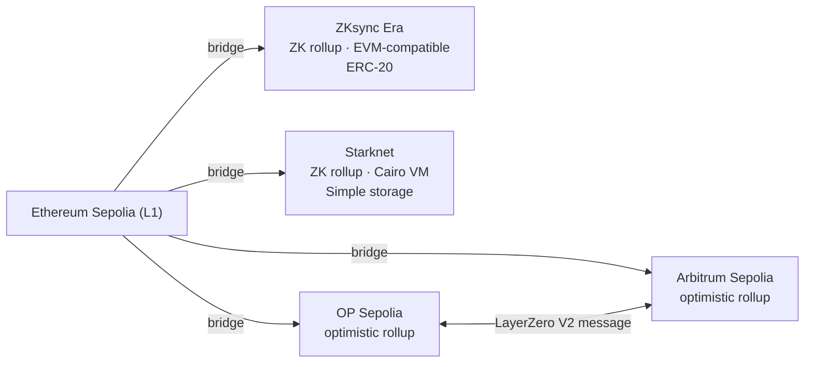

# Layer 2 Deployments – ZKsync, Starknet & LayerZero

Three small projects, each deployed and verified on a public testnet, to understand how Layer 2s
actually differ: an EVM-compatible ZK rollup, a ZK rollup with its own VM and language, and
cross-chain messaging between two optimistic rollups.

**Highlights**

- **ZKsync Era:** ERC-20 deployed with standard Foundry through ZKsync's EVM Bytecode Interpreter and verified manually on the explorer
- **Starknet:** Cairo contract written, tested with `snforge` and deployed with `sncast`, including declaring the class and deploying my own account contract (native account abstraction)
- **LayerZero V2:** OApp on OP Sepolia and Arbitrum Sepolia, wired as peers, live message sent and traced from the `PacketSent` event to the stored value on the destination chain
- 20 tests across Foundry and Starknet Foundry, incl. a fuzz test and LayerZero's local endpoint test helper

**Stack:** Solidity · Cairo · Foundry · Starknet Foundry · Scarb · Hardhat · LayerZero V2 · OpenZeppelin

> Built as part of Metana's Full Stack Web3 Bootcamp.

---

## Projects

| Folder | Network | What it is | What it proves |
|---|---|---|---|
| [`zksync-erc20/`](./zksync-erc20) | ZKsync Era Sepolia | Fixed-supply ERC-20 (`ADR`) on OpenZeppelin v5 | Deploying to a ZK rollup with standard EVM tooling, contract verification by matching compiler settings |
| [`starknet-cairo-storage/`](./starknet-cairo-storage) | Starknet Sepolia | Simple storage contract in Cairo | A non-EVM toolchain end to end: interface/impl structure, `felt252`, declare vs. deploy, account abstraction |
| [`layerzero-oapp/`](./layerzero-oapp) | OP Sepolia ↔ Arbitrum Sepolia | LayerZero V2 OApp sending a string between chains | Peers as a trust whitelist, fee quoting, enforced options, asynchronous delivery |

Each folder has its own README with addresses, transactions, commands, tests and the problems I ran into.

## Live on Testnet

| Project | Network | Contract | Proof it works |
|---|---|---|---|
| ERC-20 `ADR` | ZKsync Era Sepolia | [`0x1ca1…0774`](https://sepolia.explorer.zksync.io/address/0x1ca15D24F2A6eD115df255Ad2802CC6Db71F0774) (verified) | [Deploy tx](https://sepolia.explorer.zksync.io/tx/0x822f7c82f47a6bd329d3518f1355c7d7d0b380f3f29da99f9806d1b22a776ecf) · 1,000,000 ADR minted to deployer |
| Simple storage (Cairo) | Starknet Sepolia | [`0x03a8…a2e1`](https://sepolia.voyager.online/contract/0x03a814d480ff3991a5ac8dea3d5747f96a5cf4a2949ee216dd210c965514a2e1) | [`set_value(42)` tx](https://sepolia.voyager.online/tx/0x07bf2c5414e51c380e3014ac339f401c27a1f77e82595eed7e8f8fd9a0a7653a) · `get_value` returns `0x2a` |
| LayerZero OApp | OP Sepolia | [`0x1ca1…0774`](https://sepolia-optimism.etherscan.io/address/0x1ca15D24F2A6eD115df255Ad2802CC6Db71F0774) | [Message on LayerZero Scan](https://testnet.layerzeroscan.com/tx/0x9b437c2987d293a7db77a5540238a0ea69881b61b76745cf6a3ac1853f10e614) · "Hello from OP" |
| LayerZero OApp | Arbitrum Sepolia | [`0x1ca1…0774`](https://sepolia.arbiscan.io/address/0x1ca15D24F2A6eD115df255Ad2802CC6Db71F0774) | `lastMessage()` returns `"Hello from OP"` |



---

## How the three L2s compare

| | ZKsync Era | Starknet | OP / Arbitrum |
|---|---|---|---|
| Rollup type | ZK | ZK | Optimistic |
| Finality on L1 | after the validity proof is verified | after the validity proof is verified | after a ~7-day challenge window |
| VM | EraVM (+ EVM Bytecode Interpreter) | Cairo VM | EVM-equivalent |
| Language | Solidity | Cairo | Solidity |
| Accounts | EOAs + native account abstraction | every account is a contract | EOAs |
| Tooling I used | Foundry | Scarb + Starknet Foundry (WSL) | Hardhat + Foundry (LayerZero template) |

---

## Key Takeaways

- **"EVM-compatible" is a spectrum.** OP and Arbitrum run standard EVM bytecode. ZKsync has its own VM and only recently runs EVM bytecode through an interpreter, which is why Foundry's local gas simulation had to be skipped. Starknet isn't EVM at all.
- **Verification is reproducible compilation.** The explorer recompiles the source and compares bytecode, so compiler version, optimizer, EVM version and constructor arguments all have to match exactly.
- **Cross-chain means trust configuration.** In LayerZero, the security of an app is the peers it accepts and the DVNs that verify messages. Without a peer, sending fails; messages from any other sender are rejected.
- **Tooling breaks at the edges.** `foundry-zksync` didn't install on Windows, Starknet tooling needs WSL, faucets required mainnet balances, default RPCs didn't respond. Reading current docs and falling back to plain tools (`cast`, bridges, explicit RPC URLs) solved each one.

---

## Repository Setup

```bash
# ZKsync ERC-20 (Foundry)
cd zksync-erc20
forge install OpenZeppelin/openzeppelin-contracts foundry-rs/forge-std --no-git
forge build && forge test

# Starknet (Scarb + Starknet Foundry, on Windows inside WSL)
cd ../starknet-cairo-storage
scarb build && snforge test

# LayerZero OApp (Hardhat + Foundry)
cd ../layerzero-oapp
npm install          # or pnpm install, depending on the lockfile
forge test
```

No private keys are stored in this repository. Deployments used a Foundry keystore; the LayerZero
Hardhat deployment used a testnet-only wallet via a local `.env`, which is git-ignored.
